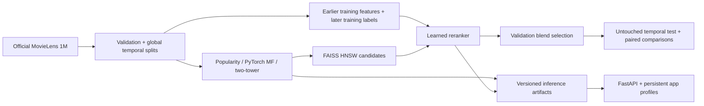

# RecForge

A Python 3.12 recommendation engine built around a reproducible question: **does a neural two-tower retriever beat rating matrix factorization, and does learned reranking improve NDCG@10?**

This implementation prioritizes the Phase 3 milestone: real MovieLens 1M training, strict temporal evaluation, FAISS retrieval, learned reranking, and a small serving API. It is a functioning local ML system, not a claim that the entire production infrastructure roadmap is complete.



## Run locally

```bash
python3.12 -m venv .venv
source .venv/bin/activate
pip install -e '.[dev,experiments]'
pytest -q
python -m recforge.cli download
# Development defaults to validation-only evaluation.
python -m recforge.cli train --output artifacts/development
# Freeze configuration before explicitly unlocking the test set.
python -m recforge.cli train --output artifacts/run-42 --final-test
RECFORGE_ARTIFACT=artifacts/run-42 uvicorn recforge.api:app --host 127.0.0.1 --port 8000
```

The exact dependency versions used locally are in `requirements-lock.txt` (Python 3.12, macOS ARM64). Install that file before the editable package to reproduce this environment; a different platform may need equivalent platform wheels. Runs reject existing output directories. No training occurs in request handlers.

Download from the [official GroupLens MovieLens 1M source](https://grouplens.org/datasets/movielens/1m/). Read the downloaded dataset README and comply with its licensing and redistribution terms. The downloader extracts only expected archive members and records source URL and archive hash. Raw data, environments, trained binaries, and local databases are ignored by Git.

## What is implemented

- Ingestion, validation, first-observation deduplication, stable ID mappings, genre features, timestamp-safe splits, and dataset hashes.
- Training-only popularity; PyTorch biased MF with rating MSE; normalized, metadata-aware two-tower MLP with BPR, mini-batches, deterministic seeds, early stopping, and checkpoints.
- FAISS exact and HNSW retrieval, seen-item filtering, temporal supervised reranker, independently serialized ranker and retrieval arrays, validation-selected blending.
- Recall@5/10, Precision@10, NDCG@10, Hit Rate@10, MRR@10, coverage, MF RMSE/MAE, cold versus established users, paired bootstrap intervals, CSV/JSON reports, and Matplotlib charts.
- Optional MLflow experiment logging and Optuna validation-only tuning; multi-seed aggregation and HTTP performance harnesses.
- FastAPI profiles, ratings, recommendations, feedback, catalog search, model metadata, health/readiness, and Prometheus counters/histograms. SQLite persistence and bounded, 60-second in-process caching keep local operation simple.
- Synthetic unit/integration tests, a CPU CI workflow, and a minimal inference Docker image/Compose service.

See [the evaluation contract](docs/evaluation.md) for the exact candidate universe, cohort definitions, negative sampling, selection rules, and known confounders.

## Measured results

Three CPU runs on MovieLens 1M (seeds 42, 43, 44), evaluated on 985 established test users:

| Model | NDCG@10, mean ± SD |
|---|---:|
| Popularity | 0.1971 ± 0.0000 |
| Rating matrix factorization | 0.1491 ± 0.0025 |
| Two-tower ANN retrieval | 0.1979 ± 0.0042 |
| Validation-selected two-stage blend | **0.2118 ± 0.0033** |

The blend improves NDCG@10 by **7.1% relative** over ANN retrieval. All three paired user-bootstrap intervals exclude zero. Pure reranking performs worse; the improvement requires validation-selected blending. Neural retrieval is close to popularity, so this benchmark does not establish a strong neural advantage over that simple baseline.


See [the measured benchmark report](benchmarks/RESULTS.md) for pure-ranker results, uncertainty, cold users, retrieval fidelity, HTTP/cache/concurrency measurements, and limitations. Raw JSON/CSV reports and per-user scores are included. **14 tests passed**; a real MLflow run completed. The local artifact folders contain all three trained model versions.

At 100 candidates, seed 42 ANN recall against exact search was 97.7%; search latency was effectively similar at this small catalog size. The HTTP two-stage endpoint averaged 7.40 ms uncached and 1.95 ms cached at concurrency one in a 100-request workload. Uncached throughput degraded under concurrency; these are local measurements, not production capacity claims.

## Serving API

Open `http://127.0.0.1:8000/docs` for interactive schemas. `POST /users` returns an opaque profile ID and a secret bearer token. Store the token; it is returned only at creation. Profile endpoints require `Authorization: Bearer TOKEN` and check ownership. These profiles are entirely separate from MovieLens training identities.

```bash
curl -X POST http://127.0.0.1:8000/users
curl 'http://127.0.0.1:8000/movies?q=Toy%20Story'
curl -X POST http://127.0.0.1:8000/users/PROFILE_ID/ratings \
  -H 'Authorization: Bearer TOKEN' -H 'Content-Type: application/json' \
  -d '{"movie_id":1,"rating":5}'
curl 'http://127.0.0.1:8000/users/PROFILE_ID/recommendations?model=two_tower&count=10' \
  -H 'Authorization: Bearer TOKEN'
```

New profiles receive training-popularity recommendations. After positive ratings, the neural query is a weighted centroid of liked-item embeddings; MF fits a small regularized user factor without retraining global models. Known rated items are excluded. Optional genre filtering applies before candidate selection. Application profiles use exact filtered search over the small catalog; the offline trained-user ANN benchmark uses HNSW. Scores are model-specific and not probabilities. Only the MF profile path returns predicted ratings; its adaptation accuracy has not yet been measured. Reranker adaptation to app profiles also needs separate validation.

Ratings immediately change the profile revision, invalidating its cache keys. Feedback is persisted against an owned recommendation event; it is not automatically converted to a rating or used to retrain. Cached requests still produce fresh events. The service intentionally serializes CPU inference to avoid thread oversubscription. The cache is per-process, not shared across workers.

## Experiments and performance

```bash
python -m recforge.cli train --output artifacts/tracked \
  --tracking-uri sqlite:///mlflow.db
# Tune only before final test evaluation:
python -m recforge.cli tune --trials 5 --output artifacts/tuning
# Use a disposable DB for load tests; the harness creates profiles and events.
RECFORGE_DATABASE=benchmark-profiles.db uvicorn recforge.api:app --port 8000
PYTHONPATH=. python benchmarks/scripts/serving.py --requests 100
PYTHONPATH=. python benchmarks/scripts/aggregate.py \
  benchmarks/results/run-42/report.json benchmarks/results/run-43/report.json \
  benchmarks/results/run-44/report.json
```

To produce seed runs, copy the default JSON and change only `seed`. Use fresh artifact directories. The aggregation script checks matching configurations, dataset versions, and split protocols. Log results from all predeclared seeds, including negative outcomes. MLflow logging is optional and occurs after successful artifact generation, so model results remain available if the tracker is unavailable.

## Container

After training `artifacts/run-42`, run `docker compose up --build`. The image runs as an unprivileged user, mounts models read-only, persists profiles in a named volume, and exposes the service on localhost. Container build and EC2 deployment require separate validation on the target host. This is not an internet-facing deployment configuration.

## Remaining work and limits

The implemented scope is the ML foundation through retrieval/ranking plus a local API. PostgreSQL/Redis, Streamlit, Grafana dashboards, automated retraining and promotion/rollback, DVC, and EC2 provisioning are deliberately deferred. Hash manifests provide local dataset/artifact traceability; they are not a full model registry. Prometheus metrics provide basic observability; drift detection and delayed-label quality monitoring remain to be built.

Before exposing the API publicly, add managed authentication/token lifecycle, TLS, rate limiting, migrations, backups, and operational load testing. Tokens currently identify local profiles rather than real user accounts. Model artifacts must be trusted: the scikit-learn ranker uses joblib serialization. Checksums detect corruption, not malicious artifact authors.

MovieLens is an explicit-rating, historically collected dataset; unobserved items are not verified dislikes. Offline ranking measures relevance among observed ratings and cannot establish online user satisfaction. The MF-versus-two-tower comparison changes both objective and architecture. The temporal reranker's feature distribution changes after base-model refitting. Cold-start movie quality, app-profile adaptation, online feedback learning, and 32M scaling are unmeasured. Read these limitations alongside any resume claims.
