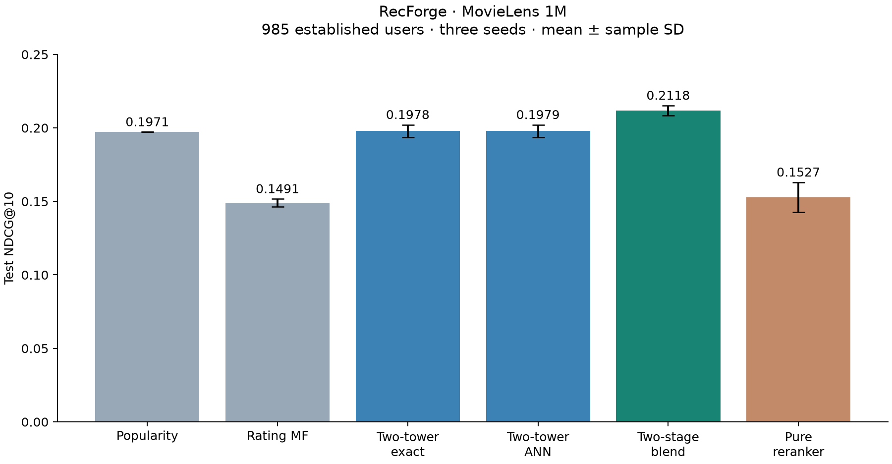

# Measured benchmark results

Python 3.12, MovieLens 1M, CPU execution. Global temporal 80/10/10 split; full training-observed catalog, seen items excluded. Seeds 42, 43, 44 use the same configuration except random seed. Each seed selects its blend on validation before test scoring.

## Established-user quality

985 users with at least five training interactions and eligible test positives. Values are mean ± sample standard deviation across three independently trained seeds.

| Model | Test NDCG@10 |
|---|---:|
| popularity | 0.1971 ± 0.0000 |
| mf | 0.1491 ± 0.0025 |
| two_tower | 0.1978 ± 0.0042 |
| two_tower_ann | 0.1979 ± 0.0042 |
| two_stage | 0.2118 ± 0.0033 |
| pure_reranker | 0.1527 ± 0.0101 |

The validation-selected two-stage blend improves mean NDCG@10 by **7.1% relative** to ANN retrieval. Pure reranking hurts quality. Two-tower retrieval beats rating MF but is close to popularity. This is not evidence that neural retrieval consistently beats popularity.

## Paired uncertainty and selection

Paired user-bootstrap intervals for the absolute NDCG@10 difference (blend minus ANN). These are conditional on each fitted model; the table above separately reports training-seed variability.

| Seed | Validation-selected rank weight | Test difference | 95% bootstrap interval |
|---|---:|---:|---|
| 42 | 0.25 | 0.01425 | [0.00917, 0.01917] |
| 43 | 0.50 | 0.01295 | [0.00623, 0.01962] |
| 44 | 0.25 | 0.01466 | [0.01018, 0.01948] |

All five systems use popularity fallback for the 202 cold users, giving identical NDCG@10 of 0.1900. Another 22 test users have no eligible positive and are excluded; 50 positive test interactions are outside the eligible unseen catalog. These exclusions are visible in every raw report.

Seed 42 MF rating prediction: RMSE **0.9064**, MAE **0.7098**, on 80,211 warm user-item ratings. Rating accuracy does not establish ranking quality.

## Retrieval and serving

Seed 42 retrieval compares the first 500 established test users. Timings include seen-item filtering and single-query search.

| Candidates | ANN recall against exact | Exact mean ms | ANN mean ms |
|---:|---:|---:|---:|
| 20 | 0.9994 | 0.124 | 0.127 |
| 100 | 0.9771 | 0.162 | 0.160 |
| 300 | 0.8181 | 0.255 | 0.241 |

ANN provides no convincing speed advantage at this catalog size. Recall at 300 drops with fixed efSearch=128; that configuration is not suitable for high-recall large candidate pools. This is a measured limit, not a scale claim.

Real loopback HTTP, one Uvicorn process, 100 requests per row, ten results per response, three rated movies per application profile. SQLite reads and event writes are included. The cold/warm distinction refers to the application recommendation cache, not OS page caches. No training jobs ran during the timed workload; an earlier stalled diagnostic process remained resident, so machine isolation is not guaranteed.

| Two-stage concurrency | Cache | Mean ms | P95 ms | Requests/sec | Hit rate |
|---:|---|---:|---:|---:|---:|
| 1 | cold | 7.40 | 11.38 | 135.0 | 0% |
| 1 | warm | 1.95 | 2.88 | 511.7 | 100% |
| 4 | cold | 37.60 | 40.98 | 105.0 | 0% |
| 4 | warm | 6.88 | 15.54 | 574.7 | 100% |
| 8 | cold | 105.05 | 117.15 | 73.5 | 0% |
| 8 | warm | 13.44 | 32.28 | 544.2 | 100% |

Uncached throughput falls under concurrent load: the local service serializes inference and persists events in SQLite. This is a limitation to address before production scaling. Cached performance is not a substitute for measuring uncached latency.

Training-pipeline durations (including preprocessing and validation blend selection) were 77.0, 73.1, 78.7 seconds. Seed 42 model loading took 0.577 seconds; peak training-process RSS was 594.9 MiB. These are single local observations.

Runtime: macOS 15.7.4 ARM64, Python 3.12.15, PyTorch 2.15.0, FAISS 1.15.1, NumPy 2.5.4. Four configured Torch/BLAS threads; one thread during HNSW construction. The sandbox denied CPU-brand/RAM queries, so the hardware description is incomplete. Raw environment metadata is included in reports; performance is not a cross-machine guarantee.

## Reproduce and inspect

Run the commands in the project README. `benchmarks/scripts/aggregate.py` validates matching runs and exports seed summaries; `benchmarks/scripts/summary.py` rebuilds this report and chart. `benchmarks/scripts/stages.py` measures retrieval, feature construction, and ranking separately. Full reports, per-user metrics, and retrieval CSVs are under `results/run-42`, `results/run-43`, and `results/run-44`.

14 synthetic tests passed, including end-to-end training/report generation, leakage invariance, deterministic training, serialization, cache invalidation, and API identity isolation. A real MLflow run (`run-43`) completed with 16 metrics, 15 parameters, model artifacts, and evaluation artifacts. Optuna's search entry point is implemented but a full tuning study was not run. Docker/CI configurations were authored but not executed on their target platforms.

## Resume wording supported by these measurements

Built a Python/PyTorch recommendation pipeline on MovieLens 1M with chronological evaluation, FAISS HNSW retrieval, and temporal supervised reranking; improved established-user NDCG@10 by 7.1% over neural ANN retrieval across three seeds using validation-selected blending.

Paired this with a FastAPI profile service, versioned artifacts, MLflow logging, leakage tests, and measured cache/concurrency benchmarks. Avoid claiming production deployment, online business impact, ANN acceleration at scale, or that pure reranking improved quality.
